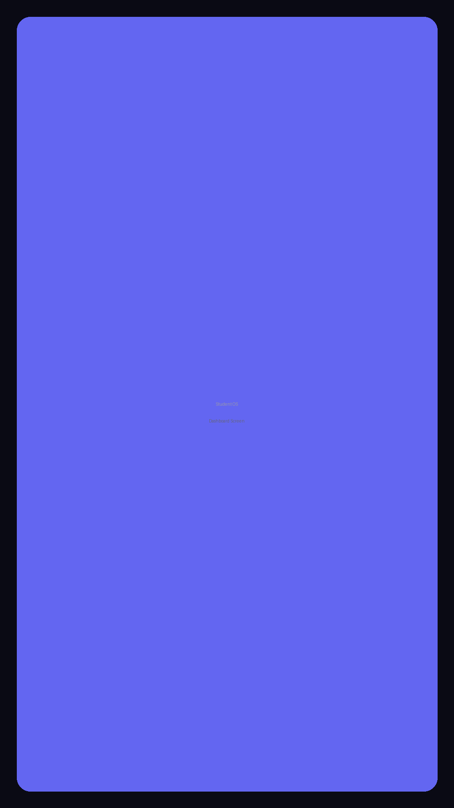
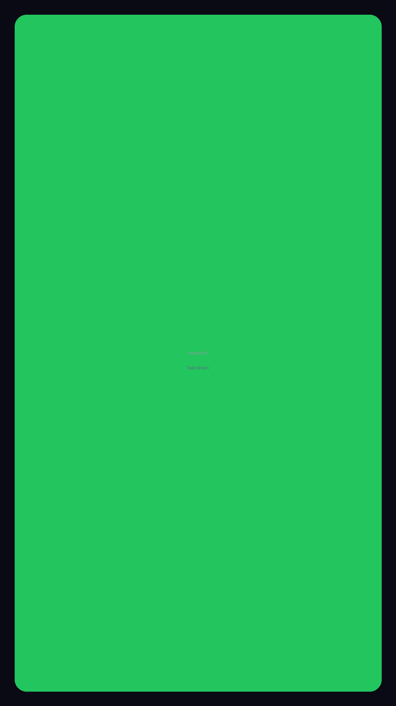
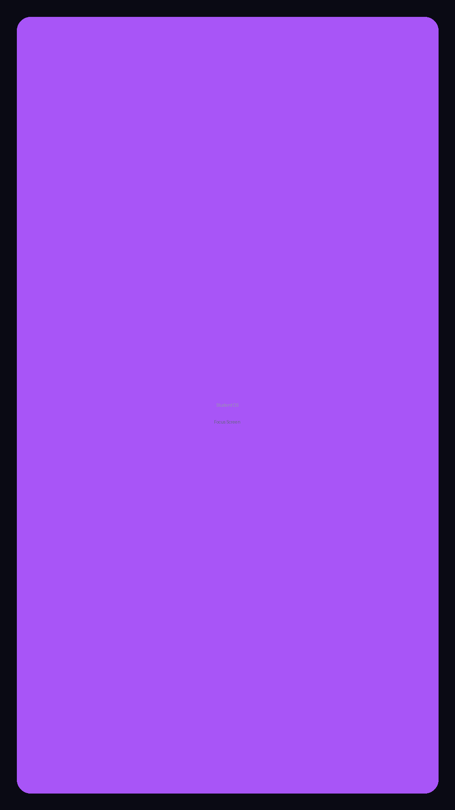

<div align="center">

# Student OS

**A calm, offline-first study workspace for ambitious students.**

Focus timer · Tasks · Habits · Planner · Analytics · Deep Lock — in one premium, private app.

[](https://github.com/jainam6610/student-os/actions/workflows/ci.yml)
[](https://github.com/jainam6610/student-os/releases)
[](./LICENSE)
[](https://play.google.com/store/apps/details?id=com.jainam.studentos)
[](https://nextjs.org)
[](https://react.dev)
[](https://www.typescriptlang.org)
[](./CONTRIBUTING.md)

</div>

---

## 📲 Get Student OS

<a href="https://play.google.com/store/apps/details?id=com.jainam.studentos">
  
</a>

| Platform | How to install |
|----------|----------------|
| **Android** | [**Google Play**](https://play.google.com/store/apps/details?id=com.jainam.studentos) (recommended) · or download the [**latest APK**](https://github.com/jainam6610/student-os/releases/latest) from the Releases page |
| **Web / Desktop** | It's a PWA — open the app in a browser and choose *"Add to Home Screen"* / *"Install"* to use it offline |
| **Build from source** | See [Getting Started](#getting-started) below |

> The APK on the Releases page is a **debug build** intended for sideloading and testing. For everyday use, install from Google Play.

## Why Student OS

Most student tools are either over-engineered (endless setup, cloud accounts, noise) or under-designed (a bare todo list with no reason to come back). Student OS sits in the middle: **opinionated but not rigid, premium but not complex, minimal but not sparse.**

It is built around one belief — **consistency beats intensity.**

- 🔒 **Local-first & private.** No account, no server, no telemetry. Your data stays on your device.
- 🎯 **Focus is the centrepiece.** A timestamp-accurate deep-work timer with an ambient environment.
- 🌱 **Built for consistency.** Streaks, XP and analytics reward showing up daily, not grinding once.
- 📴 **Works offline.** Installable as a PWA or a native Android app.

## Features

| | Feature | What it does |
|---|---|---|
| ⏱️ | **Focus Mode** | Timestamp-accurate timer (no drift), presets + custom duration, ambient soundscape, session stats |
| ✅ | **Tasks** | List & kanban views, priorities, subjects, due dates, subtasks, XP rewards |
| 🔥 | **Habits** | Weekly grid, streak mechanics, celebration animations |
| 📅 | **Planner** | Month / week / day views, syllabus tracking, exam countdown |
| 📊 | **Analytics** | Focus trends, subject breakdown, peak-productivity insights |
| 🛡️ | **Deep Lock** | Android Focus Shield that blocks distracting apps during sessions |
| ⌘ | **Command Palette** | ⌘K / Ctrl+K access to every view and action |
| ⚙️ | **Settings** | Themes (light / dark / AMOLED), avatar, data export |

## Tech Stack

- **Framework:** Next.js 16 (App Router, static export) + React 19
- **Language:** TypeScript 5.7 (strict)
- **Styling:** Tailwind CSS v4 + OKLCH design tokens, glass-morphism
- **Animation:** Framer Motion 12
- **State:** Zustand 5 (persisted to `localStorage`)
- **Charts:** Recharts 2
- **Mobile:** Capacitor 8 (Android shell + native alarm & Focus Shield plugins)
- **Icons:** Lucide · **Dates:** date-fns · **IndexedDB:** Dexie

## Screenshots

<div align="center">
  
  
  
</div>

## Getting Started

**Requirements:** Node.js 20+ and pnpm.

```bash
# 1. Install dependencies
pnpm install

# 2. Start the dev server
pnpm dev
# open http://localhost:3000
```

### Useful scripts

| Script | Description |
|---|---|
| `pnpm dev` | Start the Next.js dev server |
| `pnpm build` | Production build (static export to `out/`) |
| `pnpm check` | Types + lint + build (the full gate) |
| `pnpm lint` | ESLint |
| `pnpm verify` | Release verification |

### Android

The web app is wrapped for Android with Capacitor.

```bash
pnpm build            # export the web app to out/
npx cap sync android  # copy web assets into the Android project
npx cap open android  # open in Android Studio, or:
cd android && ./gradlew assembleDebug
```

> The Android module includes a custom alarm scheduling plugin and a Focus Shield (accessibility-based) subsystem.

## Project Structure

```
app/            Next.js app shell (single-page routing, global styles)
components/     All views + UI primitives (ui/, focus/, planner/, deep-lock/ …)
Focus/          Focus-mode subsystem (timer, service, native bridge)
hooks/          Shared React hooks
lib/            State (Zustand slices), domain logic, utilities
data/           Static data (quotes, syllabus presets)
public/         PWA assets (manifest, service worker, icons)
android/        Capacitor Android project (Kotlin/Java)
docs/           Compliance, privacy & architecture documentation
```

## Privacy

Student OS is **local-first by design**. There is no account and no backend.

- All data lives in your browser's `localStorage` (and optionally IndexedDB).
- Nothing is transmitted to any server.
- The Android **Accessibility Service** is used *only* during a Deep Lock focus session to detect the foreground app. It does **not** read screen content, messages, passwords or typed text.

See [`docs/PRIVACY_POLICY.md`](./docs/PRIVACY_POLICY.md) and [`docs/SECURITY.md`](./docs/SECURITY.md) for details.

## Roadmap

- [ ] Recurring tasks
- [ ] Markdown notes per subject
- [ ] Drag-and-drop task ordering
- [ ] Focus mode white-noise / lo-fi player
- [ ] End-to-end encrypted sync
- [ ] Flashcards with spaced repetition
- [ ] Desktop builds (Tauri)

See the [open issues](https://github.com/jainam6610/student-os/issues) for the full list.

## Contributing

Contributions are welcome! Please read [`CONTRIBUTING.md`](./CONTRIBUTING.md) and our [`CODE_OF_CONDUCT.md`](./CODE_OF_CONDUCT.md) first. This project uses [Conventional Commits](https://www.conventionalcommits.org/).

## License

Released under the [MIT License](./LICENSE).

<div align="center"><sub>Built by Jainam Karnawat</sub></div>
